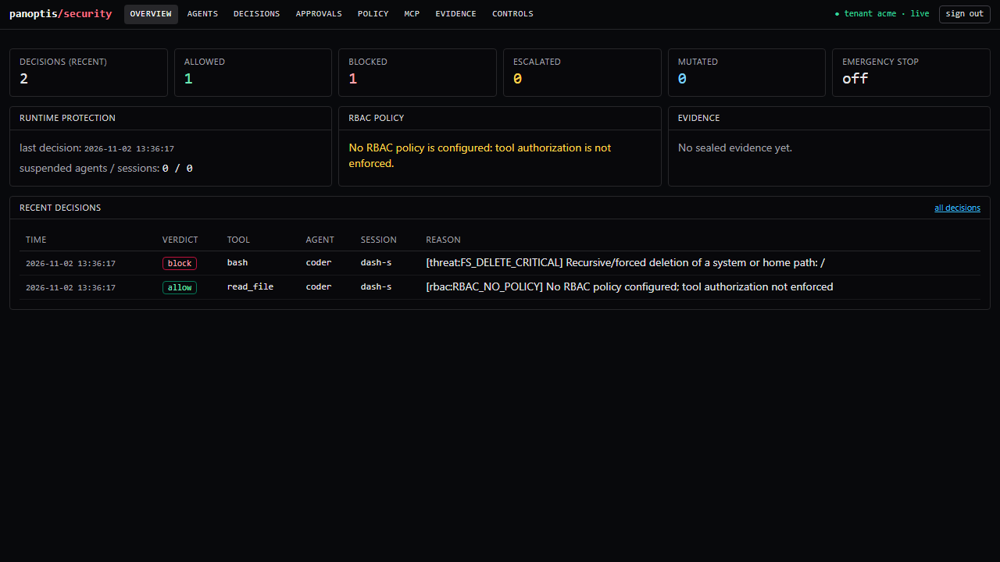

# Security dashboard

The security views of the AgentWatch dashboard are under `/security`, in the `frontend/` Next.js app. Everything shown comes from the [protection API](PROTECT_API.md). Nothing is fabricated or static: an empty store shows empty states, and an unreachable API shows "disconnected" rather than old data.



## Signing in

The dashboard holds no credential. Each user signs in with their own AgentWatch API key, kept in `sessionStorage` for the browser tab only, and every request carries it as `X-API-Key` through the dashboard's `/api/v1` proxy. The server decides what the key may see:

- **A tenant key** shows that tenant only.
- **The operator key** shows the `default` tenant and is required for the global emergency stop.
- **Signing out** discards everything fetched with the previous key.

## Views

| View | Shows | Operates |
|---|---|---|
| Overview | verdict counts, last decision, emergency-stop banner, policy and evidence summary, recent decisions | — |
| Agents | agents and sessions with protected calls (objective, counts, suspension); the recorded discovery inventory, where only `MONITORED` is green | suspend/resume an agent or session (tenant) |
| Decisions | filterable decisions (verdict, stage, tool, agent); call detail with findings, approval, execution and output inspection; loop and intent-grounding events | — |
| Approvals | pending and decided requests, with the exact arguments and action digest | approve/reject; the decision names the digest shown |
| Policy | active RBAC policy (roles, bindings, digest, last reload error), effective permissions per agent | dry-run check of a call |
| MCP | servers behind the gateway, recent gateway calls, configured MCP servers from discovery | — |
| Evidence | Merkle chain verification (errors and warnings), head anchor, inclusion proof of a record | verify now, optionally sealing first |
| Controls | emergency-stop state and suspensions of the tenant | emergency stop / lift (operator; confirmation and reason required), resume |

Every view has loading, empty, error, disconnected, rejected-key and operator-only states. A view that cannot render the data it received shows an error instead of a blank page. Data refreshes every 5 seconds (approvals every 2 s). The header shows `live` or `stale (Ns)` per the last successful refresh.

## Running it

```bash
docker compose up -d                     # API on :8000, dashboard on :3000 (AGENTWATCH_API_URL wired)
# or locally
uvicorn panoptis.api.server:app --port 8000
cd frontend && AGENTWATCH_API_URL=http://127.0.0.1:8000 npm run dev
```

Open `http://localhost:3000/security` and sign in with your key.

## Tests

- **Component and accessibility tests.** `frontend/__tests__/security.test.tsx` (Jest, Testing Library, `jest-axe`) covers:
  - sign-in, and that the key is sent;
  - backend counts and the kill banner;
  - empty, disconnected and rejected-key states;
  - filters and the call detail;
  - the approval sends the exact digest;
  - discovery never shows unmonitored as protected;
  - the emergency stop needs a reason and confirmation, and a 403 is explained;
  - failed verification is shown;
  - policy dry-run;
  - no axe violations on five views.
- **Browser E2E against a running backend.** `tests/e2e_dashboard/test_dashboard_e2e.py` (Playwright and Chromium; opt-in with `AGENTWATCH_E2E_DASHBOARD=1`) starts the API (uvicorn), the production build (`next start`) and a real protected agent. It proves:
  - a tenant sees its real decisions and never another tenant's;
  - approving in the browser releases the waiting agent, and the tool runs once;
  - the emergency stop is refused to a tenant key, works with the operator key, blocks the agent, and lifting it restores execution;
  - a disconnected backend is shown.

Screenshots from that run are in `docs/screenshots/dashboard/`.
