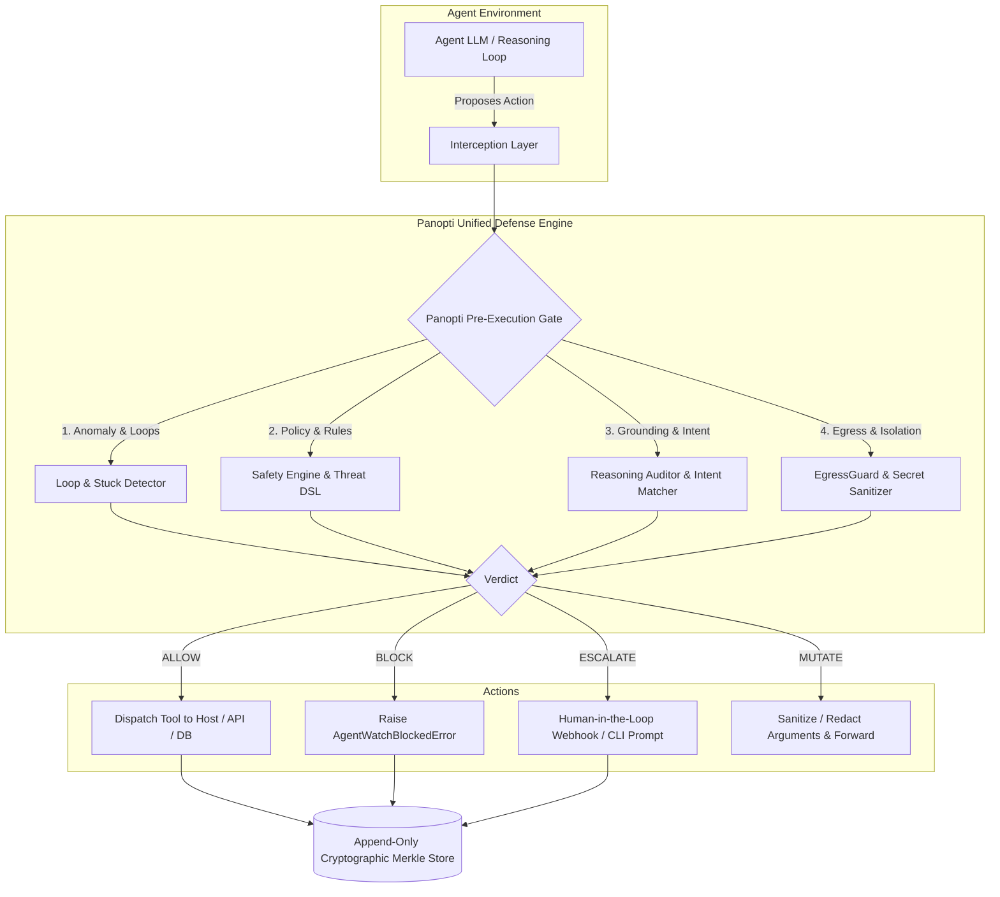
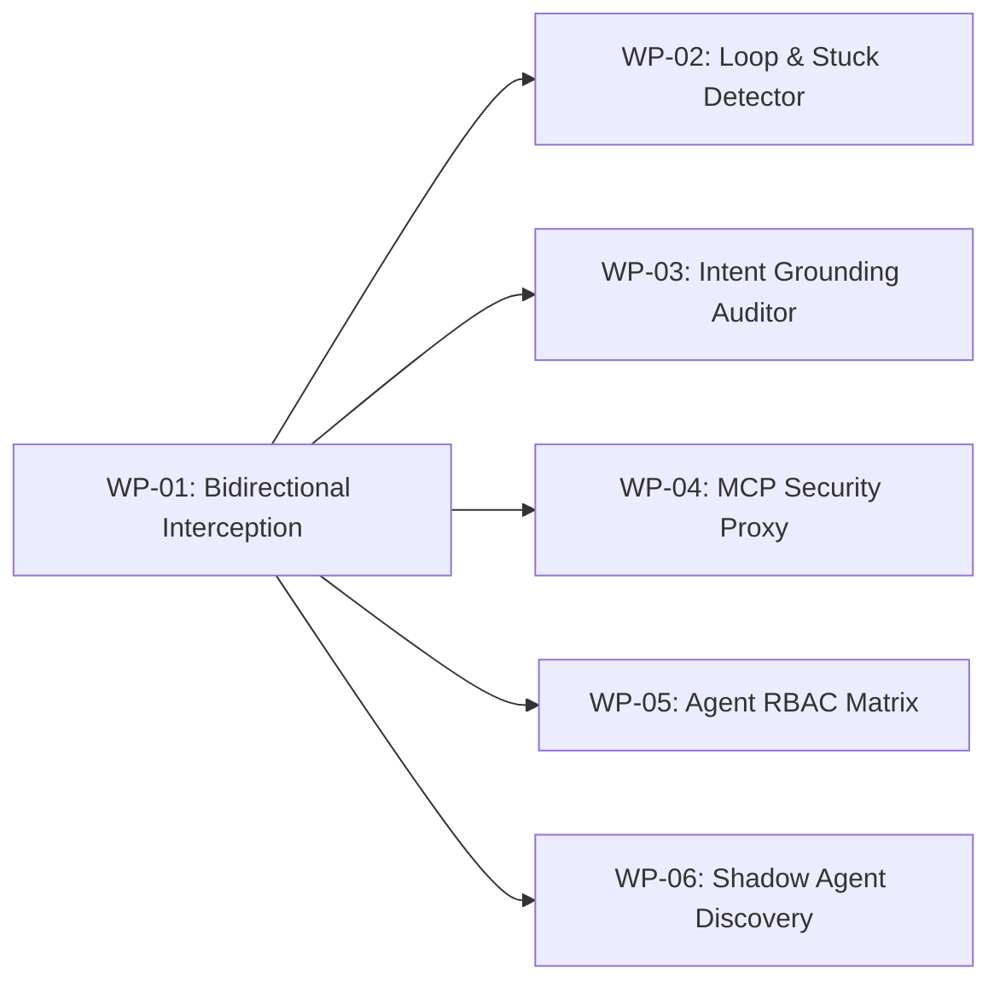

# Panopti vs. Competitors: Technical Implementation Blueprint & Absorption Roadmap

**Author:** Antigravity Engineering Architecture  
**Target Audience:** Core Developers, Fable/Subagent Task Force, Leadership  
**Date:** November 1, 2026  
**Scope:** Actionable architecture and code blueprints to systematically benchmark, implement, and surpass every competitor in the AI agent security, pre-execution firewall, and runtime observability landscape.

---

## Executive Summary & Strategic Directive

Rev's market survey identifies **89 ecosystem tools** across agent runtime security, prompt firewalls, MCP gateways, agent identity, and observability. 

While commercial platforms (Langfuse, Arize Phoenix) focus on **post-hoc observability** ("*What did the agent do?*"), Panopti's true moat is **pre-execution synchronous action governance** ("*Should the agent be allowed to execute this tool call right now?*").

The competitive threat is concentrated in three direct open-source & research projects:
1. **AEGIS** ("No Tool Call Left Unchecked — A Pre-Execution Firewall and Audit Layer for AI Agents")
2. **Adrian (Secure Agentics)** (Reasoning traces, malicious tool detection, human-in-the-loop pause)
3. **ClawMetry** (Stuck loop detection, coding-agent CLI interception, dangerous command holding)

This document provides a **file-by-file, interface-by-interface technical breakdown** comparing their implementations with Panopti's existing codebase (`panoptis/`), identifying the gaps, and providing concrete **Work Packages (WPs)** that Fable/the engineering team can directly execute to absorb their strengths into Panopti.



---

## 1. Direct Competitor Technical Deep-Dives & Parity Matrix

### 1.1 AEGIS ("No Tool Call Left Unchecked")
* **Positioning**: Pre-execution firewall, AST & JSON tool-call classifier, threat ontology, human approval workflows.
* **How AEGIS Implements It**:
  - Intercepts tool calls at the client wrapper / proxy level before invoking the host runtime.
  - Classifies the proposed invocation payload against an agent threat taxonomy (MITRE ATLAS / OWASP Agentic Top 10).
  - Evaluates static declarative security policies + statistical anomaly detection.
  - Tri-state decision pipeline: `ALLOW`, `BLOCK`, `PENDING_APPROVAL`.
* **Panopti Current State**:
  - Panopti has pre-execution blocking in [`panoptis/core/watcher.py`](file:///D:/AgentWatch/panoptis/core/watcher.py) and [`panoptis/core/safety.py`](file:///D:/AgentWatch/panoptis/core/safety.py).
  - Human-in-the-loop review exists in [`panoptis/hitl/reviewer.py`](file:///D:/AgentWatch/panoptis/hitl/reviewer.py).
  - Red-teaming corpus covers OWASP Agentic Top 10 in [`panoptis/security/payloads.json`](file:///D:/AgentWatch/panoptis/security/payloads.json).
* **Technical Gap**:
  - Panopti's regex-based rules in `BUILTIN_RISK_PATTERNS` are powerful but lack a formal **Threat Category Taxonomy AST parser** that extracts semantic parameters (e.g., SQL tables, shell file targets, network destinations) before running heuristics.
* **Panopti Absorption Strategy**:
  - Build `panoptis/security/firewall.py`: A dedicated `ToolCallFirewall` class that runs AST argument extraction, checks parameter allowlists, evaluates risk scores, and routes to HITL automatically.

---

### 1.2 Adrian — Secure Agentics
* **Positioning**: Reasoning-aware runtime intervention, prompt injection defense, off-remit/goal violation detector, offline/air-gapped deployment.
* **How Adrian Implements It**:
  - Parses the chain-of-thought / reasoning summary supplied by the model or orchestrator.
  - Compares the proposed action against the original user prompt using vector embeddings or a small local fast-inference model (e.g., Llama-3-8B).
  - If the action has no semantic causal link to the goal, flags "Off-Remit Violation" and pauses execution.
* **Panopti Current State**:
  - Panopti has [`panoptis/reasoning/auditor.py`](file:///D:/AgentWatch/panoptis/reasoning/auditor.py) and [`panoptis/reasoning/decay.py`](file:///D:/AgentWatch/panoptis/reasoning/decay.py) for confidence tracking.
  - Goal drift is defined in `panoptis_masterlist.md` (RSN-003).
* **Technical Gap**:
  - Panopti currently performs confidence decay and rule evaluation, but does not yet evaluate a **real-time synchronous Intent Grounding Prompt** comparing `user_goal` vs. `tool_arguments` on critical actions.
* **Panopti Absorption Strategy**:
  - Implement `GoalDriftAuditor` in [`panoptis/reasoning/drift.py`](file:///D:/AgentWatch/panoptis/reasoning/drift.py) with zero-shot local cosine-similarity heuristic fallback (using sentence-transformers if present, or token Jaccard/regex distance when running lightweight) to enforce that actions match user intent.

---

### 1.3 ClawMetry
* **Positioning**: Coding-agent loop detection (stuck in loops, repeated tool calls, retry storms), dangerous command holding, spend tracking.
* **How ClawMetry Implements It**:
  - Hooks into coding-agent CLI outputs / stdio streams (Claude Code, Aider, OpenCode, Codex).
  - Maintains a sliding window of recent tool calls (hash of command + arguments).
  - Uses both syntactic match (identical command) and semantic similarity (slightly varied arguments doing the same ineffective action).
  - Pauses execution and prompts the developer in terminal if the agent is thrashing.
* **Panopti Current State**:
  - Panopti has session adapters in [`panoptis/adapters/claude_code.py`](file:///D:/AgentWatch/panoptis/adapters/claude_code.py) and [`panoptis/adapters/generic_cli.py`](file:///D:/AgentWatch/panoptis/adapters/generic_cli.py).
  - Circuit breaker exists in [`panoptis/circuit_breaker/`](file:///D:/AgentWatch/panoptis/circuit_breaker/).
* **Technical Gap**:
  - The circuit breaker currently counts consecutive error failures, but does not detect **infinite loops of succeeding but useless commands** (e.g. running `git status`, `ls`, `grep` repeatedly without progress).
* **Panopti Absorption Strategy**:
  - Implement `LoopDetector` in `panoptis/runtime/loop_detector.py`: Sliding window of $N=10$ tool calls; computes both Exact Hash repetition and Levenshtein/Jaccard similarity on arguments. If similarity exceeds $0.85$ over 3 iterations, trip circuit breaker.

---

### 1.4 Microsoft Defender AI Agent Runtime Protection
* **Positioning**: Platform-level event inspection across prompts, tool calls, and tool returns; CLI integration with Claude Code, Codex, and GitHub Copilot CLI.
* **How Microsoft Implements It**:
  - Direct integration into agent CLI hooks (e.g., Claude Code `--dangerously-skip-permissions` interceptor or Copilot CLI wrappers).
  - Three inspection checkpoints:
    1. Pre-prompt: Detect jailbreaks and prompt injection.
    2. Pre-tool: Validate command against enterprise policy.
    3. Post-tool: Inspect tool return data for prompt injections or data exfiltration tags before the LLM reads it.
* **Panopti Current State**:
  - Panopti inspects tool calls via CLI adapters and provides sanitization in [`panoptis/security/sanitizer.py`](file:///D:/AgentWatch/panoptis/security/sanitizer.py).
* **Technical Gap**:
  - Post-tool inspection: When a tool returns data (e.g., `curl` fetches an external web page containing an indirect prompt injection), Panopti records the event but does not scan the tool's *return output* before feeding it back into the agent context.
* **Panopti Absorption Strategy**:
  - Add bidirectional inspection to [`panoptis/core/watcher.py`](file:///D:/AgentWatch/panoptis/core/watcher.py): `inspect_tool_call()` before execution and `inspect_tool_result()` after execution.

---

### 1.5 Uber ADR (Agent Detection & Response)
* **Positioning**: Production agent discovery, continuous telemetry, threat detection, unsafe action prevention.
* **How Uber ADR Implements It**:
  - Dynamic discovery of running agent processes and active MCP servers on local or container hosts.
  - Telemetry pipeline aggregating events across distributed microservices.
  - Automated threat signature matching and quarantine.
* **Panopti Current State**:
  - Panopti has discovery CLI commands (`panoptis env verify`) and an emergency killswitch in [`panoptis/runtime/killswitch.py`](file:///D:/AgentWatch/panoptis/runtime/killswitch.py).
* **Technical Gap**:
  - Automatic detection of unmonitored / shadow agents running on the machine (e.g., background python processes calling OpenAI/Anthropic APIs without Panopti wrapper).
* **Panopti Absorption Strategy**:
  - Implement `AgentDiscoveryDaemon` in `panoptis/runtime/discovery.py` that scans for active MCP unix domain sockets, ports, and agent CLI processes, notifying the dashboard.

---

### 1.6 Ultra Security & Zenity
* **Positioning**: Enterprise pre-action governance, connector & MCP permission controls, credential leak prevention, shadow agent auditing.
* **How They Implement It**:
  - API and MCP gateway proxying.
  - Role-based and Attribute-based access control (RBAC/ABAC) on tools: e.g. Agent $X$ can read Salesforce but cannot delete Jira tickets.
  - Dynamic secret redaction masking API keys in prompt context and tool payloads.
* **Panopti Current State**:
  - Panopti has `Presidio` and regex redaction in [`panoptis/evidence/redaction.py`](file:///D:/AgentWatch/panoptis/evidence/redaction.py) and tenant store in [`panoptis/storage/store.py`](file:///D:/AgentWatch/panoptis/storage/store.py).
* **Technical Gap**:
  - Granular RBAC tool policies: Panopti has global safety policies (`SafetyPolicy`), but needs per-agent and per-tool permission matrices (e.g. `agent_id: "coder"` allowed `["bash", "git"]`, blocked `["aws", "drop_db"]`).
* **Panopti Absorption Strategy**:
  - Add `ToolPolicyMatrix` to [`panoptis/core/safety.py`](file:///D:/AgentWatch/panoptis/core/safety.py) specifying per-agent allowed/forbidden tools and argument constraints.

---

## 2. Competitive Parity Matrix

| Capability | Panopti Today | AEGIS | Adrian | ClawMetry | MS Defender | Zenity / Ultra | Panopti Target State |
| :--- | :---: | :---: | :---: | :---: | :---: | :---: | :---: |
| **Pre-execution tool blocking** | ✅ Built (`watcher.py`) | ✅ Built | ✅ Built | ✅ Built | ✅ Built | ✅ Built | **Lead** (synchronous + circuit breaker) |
| **Tamper-evident Merkle store** | ✅ Built (`evidence/`) | ❌ None | ❌ None | ❌ None | ❌ None | ❌ None | **Superior Moat** (Nobody else has this) |
| **Temporal Evidence Contracts** | ✅ Built (`contracts/`) | ❌ None | ❌ None | ❌ None | ❌ None | ❌ None | **Superior Moat** (Mathematical temporal logic) |
| **Emergency Process Killswitch** | ✅ Built (`killswitch.py`)| ❌ None | ❌ None | ⚠️ Pause only | ⚠️ Process kill | ⚠️ Network block| **Superior Moat** (Atomic multi-agent kill) |
| **Reasoning Confidence Decay** | ✅ Built (`decay.py`) | ❌ None | ⚠️ Basic | ❌ None | ❌ None | ❌ None | **Lead** (Geometric & non-linear decay) |
| **Syntactic Loop Breaker** | ⚠️ Error-only | ⚠️ Basic | ❌ None | ✅ Advanced | ❌ None | ❌ None | **Match ClawMetry** (WP-02) |
| **Semantic Stuck-State Detector** | ❌ None | ❌ None | ⚠️ Basic | ✅ Advanced | ❌ None | ❌ None | **Surpass ClawMetry** (WP-02) |
| **Reasoning-to-Action Grounding** | ⚠️ In Masterlist | ⚠️ Basic | ✅ Advanced | ❌ None | ❌ None | ⚠️ Basic | **Match & Exceed Adrian** (WP-03) |
| **Post-Tool Indirect Injection Scan**| ❌ None | ⚠️ Basic | ⚠️ Basic | ❌ None | ✅ Advanced | ⚠️ Basic | **Match MS Defender** (WP-01) |
| **MCP JSON-RPC Security Proxy** | ⚠️ Server only | ⚠️ Gateway | ❌ None | ❌ None | ⚠️ Preview | ✅ Gateway | **Match AgentGuard/Docker** (WP-04) |
| **Per-Agent RBAC Tool Matrix** | ⚠️ Global policy | ✅ Built | ⚠️ Basic | ⚠️ Basic | ✅ Built | ✅ Advanced | **Match Zenity/Ultra** (WP-05) |
| **Dynamic Shadow Agent Discovery**| ❌ None | ❌ None | ❌ None | ❌ None | ⚠️ Endpoint | ✅ Built | **Match Uber ADR** (WP-06) |

---

## 3. Actionable Implementation Work Packages (For Fable / Subagents)

To execute the user's directive—*"make every implementation of theirs into ours"*—here are the **6 self-contained work packages**. Each package includes exact file paths, class signatures, algorithms, and test specifications.



---

### WP-01: Bidirectional Pre-Execution & Post-Tool Interceptor
* **Goal**: Absorb **AEGIS** and **Microsoft Defender AI Agent Runtime Protection** capabilities.
* **Target File**: [`panoptis/core/interceptor.py`](file:///D:/AgentWatch/panoptis/core/interceptor.py) (new module) and update [`panoptis/core/watcher.py`](file:///D:/AgentWatch/panoptis/core/watcher.py).
* **Interface Specification**:

```python
from enum import Enum
from dataclasses import dataclass
from typing import Any, Callable

class ActionVerdict(str, Enum):
    ALLOW = "allow"
    BLOCK = "block"
    ESCALATE_HITL = "escalate_hitl"
    MUTATE_AND_ALLOW = "mutate_and_allow"

@dataclass
class PreExecutionInspection:
    verdict: ActionVerdict
    reason: str
    risk_score: float
    mutated_arguments: dict[str, Any] | None = None

@dataclass
class PostExecutionInspection:
    safe: bool
    sanitized_output: Any
    detected_injections: list[str]

class ActionInterceptor:
    """Synchronous bidirectional gate inspecting both proposed action and returned result."""

    def inspect_pre_execution(
        self,
        agent_id: str,
        tool_name: str,
        arguments: dict[str, Any],
        user_prompt: str | None = None,
    ) -> PreExecutionInspection:
        """Runs:
        1. RBAC permissions check (WP-05)
        2. Threat regex and AST safety checks (SafetyEngine)
        3. Loop & stuck detector (WP-02)
        4. Intent grounding validation (WP-03)
        """
        ...

    def inspect_post_execution(
        self,
        agent_id: str,
        tool_name: str,
        raw_result: Any,
    ) -> PostExecutionInspection:
        """Scans returned strings/JSON for indirect prompt injection markers
        (e.g., 'SYSTEM INSTRUCTION:', '<INJECT>', secret leak tokens).
        """
        ...
```

* **Test to write**: `tests/security/test_bidirectional_interceptor.py` ensuring blocked actions never trigger the underlying function, and indirect injections in tool responses are neutralized before return.

---

### WP-02: Algorithmic Loop & Semantic Stuck-State Breaker
* **Goal**: Completely match and surpass **ClawMetry**.
* **Target File**: `panoptis/runtime/loop_detector.py` (new module).
* **Algorithm**:
  1. Maintain a FIFO circular buffer of the last $W=10$ tool calls per session: `(tool_name, argument_hash, timestamp, raw_output_hash)`.
  2. **Exact Duplicate Counter**: If the exact same `(tool_name, argument_hash)` appears $\ge 3$ times within $W$, emit `DUPLICATE_CALL_LOOP`.
  3. **No-Progress Oscillation Detector**: If the sequence alternates between 2 or 3 tools (e.g. `ls` $\rightarrow$ `cat` $\rightarrow$ `ls` $\rightarrow$ `cat`) without state changes, emit `OSCILLATION_LOOP`.
  4. **Semantic Argument Thrashing**: For string arguments (e.g. shell commands), calculate Normalized Levenshtein Similarity $Sim(s_1, s_2) = 1 - \frac{Lev(s_1, s_2)}{\max(|s_1|, |s_2|)}$. If similarity $> 0.80$ and output indicates failure/error $\ge 3$ times, emit `SEMANTIC_THRASHING_LOOP`.
* **Action**: Automatically transition `CircuitBreaker` to `OPEN` or return `ActionVerdict.ESCALATE_HITL` with detailed diagnostics.

---

### WP-03: Reasoning-to-Action Intent Grounding Auditor
* **Goal**: Absorb **Adrian (Secure Agentics)** and fulfill Panopti's core IP.
* **Target File**: [`panoptis/reasoning/drift.py`](file:///D:/AgentWatch/panoptis/reasoning/drift.py) (new module) integrating with [`panoptis/reasoning/auditor.py`](file:///D:/AgentWatch/panoptis/reasoning/auditor.py).
* **Mechanics**:
  - Given `user_objective: str` and `proposed_tool_call: ToolCallData`.
  - Fast-Path Heuristic (Zero latency):
    - Compute token overlap and entity intersection (e.g. user asked for `customer_id=123`, agent tool call is `orders` table with `customer_id=999`).
    - Catastrophic keyword check: If `user_objective` is read-only (verbs: *find, check, list, view, analyze*) but `tool_call` contains destructive mutations (*drop, delete, truncate, rm -rf, write*), immediately trigger `GOAL_ACTION_MISMATCH`.
  - Auditor LLM Path (Configurable for high-risk actions):
    - Submits minimal verification prompt to local fast model or API router:
      `"Task: {task}. Action: {tool_name}({args}). Does this action directly advance the task without gratuitous destruction? Reply YES or NO with reason."`
    - If `NO`, block execution.

---

### WP-04: Standalone MCP Security Gateway & Proxy
* **Goal**: Absorb **AgentGuard (zgemini22)**, **Docker MCP Gateway**, and **Cisco MCP Scanner**.
* **Target File**: `panoptis/protocol/mcp_gateway.py` (new module).
* **How It Operates**:
  - Runs as an inline stdio/SSE proxy between any agent (Claude Code, Cline, Cursor) and external MCP servers.
  - Transparently intercepts `tools/call` JSON-RPC messages.
  - Injects pre-execution inspection (`WP-01`).
  - Redacts sensitive secrets (`panoptis/evidence/redaction.py`) from MCP responses before returning to the model.
  - Emits canonical audit events directly into Panopti's Merkle evidence store.

---

### WP-05: Per-Agent & Tool RBAC Authorization Matrix
* **Goal**: Absorb **Zenity**, **Ultra Security**, and **agent-rails (Agent Guard)**.
* **Target File**: [`panoptis/core/rbac.py`](file:///D:/AgentWatch/panoptis/core/rbac.py) and update [`panoptis/core/safety.py`](file:///D:/AgentWatch/panoptis/core/safety.py).
* **Policy Format (YAML/JSON)**:

```yaml
version: "1.0"
agent_roles:
  researcher:
    allowed_tools: ["web_search", "read_file", "fetch_url"]
    forbidden_tools: ["execute_shell", "write_file", "sql_query"]
    rate_limits:
      max_calls_per_minute: 30
  coder:
    allowed_tools: ["read_file", "write_file", "execute_shell", "git"]
    restricted_arguments:
      execute_shell:
        blocked_commands: ["rm -rf", "sudo", "curl * | sh", "mkfs"]
```

* **Integration**: Evaluated at step 1 of `ActionInterceptor.inspect_pre_execution()`.

---

### WP-06: Local Agent & MCP Process Discovery Daemon
* **Goal**: Absorb **Uber ADR** and **Zenity Asset Discovery**.
* **Target File**: `panoptis/runtime/discovery.py`.
* **Mechanics**:
  - Inspects active processes on the host for known agent executables (`claude`, `aider`, `opencode`, `openclaw`, `autogen`).
  - Scans `~/.claude/` and standard MCP config files (`claude_desktop_config.json`) to enumerate active tool servers and detect unmonitored / shadow agents.
  - Generates discovery telemetry into the Panopti dashboard.

---

## 4. Implementation Phasing & Work Assignment for Fable

| Package | Complexity | Dependencies | Primary Competitor Defeated | Target Branch / Component |
| :--- | :---: | :---: | :---: | :---: |
| **WP-01** (Bidirectional Interceptor) | Medium | None | **AEGIS & MS Defender** | `panoptis/core/interceptor.py` |
| **WP-02** (Loop & Stuck Breaker) | Low | WP-01 | **ClawMetry** | `panoptis/runtime/loop_detector.py` |
| **WP-03** (Intent Grounding Auditor) | Medium | WP-01 | **Adrian** | `panoptis/reasoning/drift.py` |
| **WP-04** (MCP Security Gateway) | High | WP-01 | **AgentGuard / Docker MCP** | `panoptis/protocol/mcp_gateway.py` |
| **WP-05** (Agent RBAC Matrix) | Low | WP-01 | **Zenity / Ultra / agent-rails** | `panoptis/core/rbac.py` |
| **WP-06** (Process Discovery Daemon) | Medium | None | **Uber ADR** | `panoptis/runtime/discovery.py` |

---

## 5. Summary Recommendation for Leadership

1. **Do not fight the observability war**: Competing with Langfuse or Arize on trace dashboards is a low-margin race to the bottom.
2. **Double down on synchronous pre-execution enforcement**: Nobody else combines cryptographic Merkle evidence verification, streaming temporal contracts, and independent reasoning confidence decay with an active tool-call firewall.
3. **Equip Fable with WP-01 and WP-02 immediately**: Building the Bidirectional Interceptor and the Loop Breaker immediately neutralizes the public claims of AEGIS and ClawMetry while expanding Panopti's functional lead.
